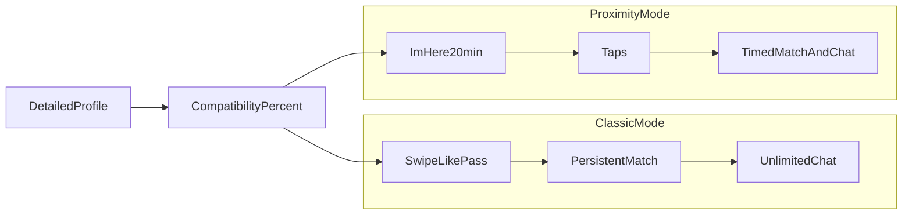

# Two-track rebuild plan (classic dating + proximity)

Write this as a standalone onboarding doc: [TWO_TRACK_PLAN.md](TWO_TRACK_PLAN.md) at the repo root. No app code in this pass.

## Product target

The app becomes a **normal dating app** with two extras:

- **Compatibility % (0–100)** on every profile the user is shown
- **Close proximity mode** (keep live radar / 20-minute window / taps)

**Classic mode:** Tinder-style **like/pass (swipe)**, **persistent match**, **unlimited chat**. People shown are filtered by who the user wants (gender already exists; add age range and similar prefs). Matching and texting behave like other dating apps.

**Proximity mode:** Keep current live flow (I’m here, fuzzed GPS, 50/100/200 m, 20-minute availability, taps, 20-minute match + timed chat). **Remove Compatibility Matching Mode** (the 10-hobby lock and 7-shared Super Match filter). **Show compatibility %** next to each nearby profile instead.

Questionnaire source of truth: [profile.txt](profile.txt) (10 Greek sections: relationship intent, relationship style, pets, kids/family, personality/values, therapy, money, going out, fitness, free time). Both languages ship for every question and option.

## How the two people work without waiting

They **do not share a sequential dependency**. They branch from current `main` the same day.

| Person | Branch | Owns |
|--------|--------|------|
| Dev A | `feat/classic-dating-i18n` | App chrome EN/EL, bottom navigation, classic swipe + likes + persistent matches, chat rules for classic vs proximity |
| Dev B | `feat/profile-compatibility-proximity` | Questionnaire UI + Firestore answers, scoring 0–100, proximity list/sheet % , delete Compatibility Mode |

**Contract (copy into the MD so both implement the same names):**

- Questionnaire answers live on `users/{uid}` as a map `profileAnswers` (stable **English keys**, never localized strings as IDs). Example keys: `relationshipType`, `relationshipPace`, `seePartnerFrequency`, `dailyCommunication`, `conflictStyle`, `hasPet`, `wantsPet`, `dateSomeoneWithPet`, `wantsKids`, `kidsTiming`, `marriageView`, `familyImportance`, `personality` (map of 5 bipolar 0–100 scores), `relationshipValues` (max 5), `therapy`, `moneyWhenHave`, `moneyInRelationship`, `moneySelf`, `goingOutFrequency`, `goingOutActivities` (max 5), `fitnessImportance`, `freeTime` (max 7).
- Display % via one function both call: `CompatibilityCalculator.percent(me: User, other: User): Int` in a new file [app/src/main/java/com/example/morvo/CompatibilityCalculator.kt](app/src/main/java/com/example/morvo/CompatibilityCalculator.kt). **Only Dev B implements the real math.** Dev A ships a **5-line stub** that returns `0` if answers are missing, so classic cards compile without waiting.
- Classic match docs: `matches/{matchId}` plus `type = "classic"` and **no** `expiresAt` (or omit it). Proximity keeps `type = "proximity"` and current `expiresAt`.
- i18n files are **split so both can edit without merge hell:**
  - Dev A: `res/values/strings.xml` + `res/values-el/strings.xml` (login, radar, chat, menus, classic swipe)
  - Dev B: `res/values/profile_questions.xml` + `res/values-el/profile_questions.xml` (all [profile.txt](profile.txt) questions/options)
- **File ownership (do not both edit):** Dev A = new classic screens, nav, likes, [ChatActivity.kt](app/src/main/java/com/example/morvo/ChatActivity.kt), [MatchesInboxActivity.kt](app/src/main/java/com/example/morvo/MatchesInboxActivity.kt). Dev B = [ProfileSetupActivity.kt](app/src/main/java/com/example/morvo/ProfileSetupActivity.kt), [User.kt](app/src/main/java/com/example/morvo/User.kt) (`profileAnswers` + drop `hobbies` / `isCompatibilityModeActive` / `vibeTag` when replaced), [DiscoveryActivity.kt](app/src/main/java/com/example/morvo/DiscoveryActivity.kt), [NearbyAdapter.kt](app/src/main/java/com/example/morvo/NearbyAdapter.kt), proximity layouts. If Dev A needs a hook on Discovery, they wrap it in nav only (`startActivity(DiscoveryActivity)`), they do not rewrite radar.

Merge order later: either branch first; the only expected conflict is a tiny stub vs real `CompatibilityCalculator` and maybe `User.kt` if Dev A added `ageMin`/`ageMax` filter prefs (put those on a nested `discoveryPrefs` map so they rarely clash).

---

## Dev A — Classic dating + English/Greek chrome

### Phase A1 — Languages

- Default English in `values/`, Greek in `values-el/`.
- In-app language switch (Settings or profile menu) that sets locale and recreates the activity so it does not depend only on the phone language.
- Extract hardcoded UI strings currently in Kotlin/XML (e.g. “Live Radar”, “Tap”, “Please verify your email first” in [MainActivity.kt](app/src/main/java/com/example/morvo/MainActivity.kt) and [activity_discovery.xml](app/src/main/res/layout/activity_discovery.xml)).
- Do **not** translate questionnaire text (Dev B’s files).

### Phase A2 — App shell: two modes

- Bottom nav (or equivalent): **Classic**, **Nearby**, **Inbox**, **Me**.
- Nearby = existing [DiscoveryActivity](app/src/main/java/com/example/morvo/DiscoveryActivity.kt) unchanged in A’s branch.
- Classic = new activity/fragment (e.g. `ClassicDiscoverActivity`) with a card stack. Empty state is fine until A3.
- After login, land on Classic (not only radar).

### Phase A3 — Classic matching (like other apps)

- New collection, e.g. `swipes/{myUid}/liked/{theirUid}` and `passed/{theirUid}` (or equivalent). Like + they already liked you → create `matches/{matchId}` with `type = "classic"`.
- Do **not** use proximity taps / 20-minute expiry for classic.
- Inbox: show classic matches always; show proximity matches only if `expiresAt` is still in the future (extend [MatchesInboxActivity.kt](app/src/main/java/com/example/morvo/MatchesInboxActivity.kt)).
- Who appears in classic: `interestedIn` / gender mutual filter (reuse `isMutuallyInterested` logic, move to a shared helper if needed), not blocked, not self, not already matched, optional age range. **Do not** require `isAvailable` or GPS.
- Show Dev A’s stub % on the card (`0` until Dev B merges).

### Phase A4 — Chat like a normal dating app

- [ChatActivity.kt](app/src/main/java/com/example/morvo/ChatActivity.kt): if `type == "classic"` or missing `expiresAt`, **hide countdown** and never disable send.
- Keep timer + lock for proximity matches.
- Report / block / unmatch stay; unmatch deletes the match but classic does not auto-expire.

### Phase A5 — “Who I want to see” filters

- Persist `discoveryPrefs` on the user: e.g. `ageMin`, `ageMax` (and later city/distance if you want).
- Classic feed respects these filters. Proximity keeps gender + blocks + distance; Dev B adds % only.

---

## Dev B — Profile questionnaire, %, proximity cleanup

### Phase B1 — Catalog from profile.txt

- Encode all 10 sections from [profile.txt](profile.txt) as resource entries (EN + EL) with **stable keys** matching the contract above.
- Personality items are bipolar sliders (Introvert–Extrovert, Spontaneous–Planner, Minimalist–Materialistic, Ambitious–Laid-back, Traditional–Modern), stored 0–100.
- Multi-select caps: values ≤5, going-out ≤5, free time ≤7.

### Phase B2 — Replace current “interests” onboarding

- Rebuild [ProfileSetupActivity.kt](app/src/main/java/com/example/morvo/ProfileSetupActivity.kt) as a multi-step wizard (photos/name/age/city/gender/interestedIn stay; **remove hobby chips, vibe tag, 10-hobby lock**).
- Save with `SetOptions.merge()` including `profileAnswers`.
- Edit-profile reloads answers into the wizard.

### Phase B3 — Compatibility % (0–100)

Implement `CompatibilityCalculator` as a **weighted, documented** score (tunable constants, not magic):

- **Hard / heavy (deal-breakers):** kids (`wantsKids` yes vs no), pets (`dateSomeoneWithPet` = no vs `hasPet` = yes), relationship intent (serious/marriage vs casual/no-expectation) — large penalty or cap.
- **High:** marriage view, family importance, relationship pace, see-partner frequency, daily communication, conflict style.
- **Medium:** money trio, going-out frequency, fitness, therapy openness.
- **Overlap bonuses:** Jaccard/overlap on `relationshipValues`, `goingOutActivities`, `freeTime`.
- **Personality:** average closeness of the 5 slider pairs (distance → percent).
- Clamp to 0–100. If either user has no `profileAnswers`, return 0 (same as Dev A stub).

Both modes call this same function; **no** “compatibility mode” flag.

### Phase B4 — Proximity: drop mode, show %

- Remove `switchCompatibilityMode`, `isCompatibilityModeActive`, Super Match sort/filter, and the 7-shared-hobby notifications from [DiscoveryActivity.kt](app/src/main/java/com/example/morvo/DiscoveryActivity.kt) / [activity_discovery.xml](app/src/main/res/layout/activity_discovery.xml).
- Keep I’m here, range slider, gender filter, blocks, taps, 20-minute match.
- [NearbyAdapter.kt](app/src/main/java/com/example/morvo/NearbyAdapter.kt) + [item_nearby_user.xml](app/src/main/res/layout/item_nearby_user.xml): show **“72%”** (or equivalent) on every row.
- [dialog_profile_details.xml](app/src/main/res/layout/dialog_profile_details.xml): show the same % and questionnaire highlights (not the old hobby string list).
- Optional: sort nearby by % descending (still after inbound/outbound tap priority if you keep tap badges).

---

## What stays as-is (both tracks)

Auth (email verify + Google), ban check, photo storage path `profiles/{uid}/img_*.jpg`, block/report, location fuzzing, proximity tap/`matchId` convention `minUid_maxUid`.

## Integration (after both branches exist)

1. Replace Dev A stub with Dev B’s `CompatibilityCalculator`.
2. Classic cards call the real %.
3. Inbox already distinguishes `type`.
4. Smoke: EN/EL toggle, complete questionnaire, classic like→match→chat with no timer, proximity live→tap→timed chat with % on the row.

## Suggested first commits (same day, parallel)

- Dev A: empty `values-el/strings.xml` + language helper + bottom nav skeleton.
- Dev B: `profile_questions.xml` keys from [profile.txt](profile.txt) + empty `CompatibilityCalculator.percent = 0` (Dev A can copy this file or keep their stub; same signature).
