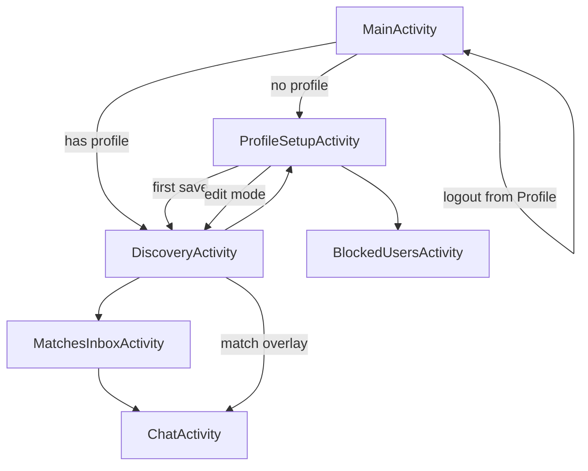

# Morvo — Developer Guide

This document explains how the Morvo Android app works and what each Kotlin and XML source file is responsible for. Morvo is a **location-based social discovery / dating app** for venues (clubs, bars, events): users go “live” nearby, see compatible profiles, send “taps” (interest signals), match, and chat for a **20-minute window** before the match expires.

**Stack:** Kotlin, Material Design 3, Firebase (Auth, Firestore, Storage), Google Play Services (Location, Google Sign-In), Glide.

**Package:** `com.example.morvo`  
**Application ID:** `com.example.morvo`

---

## How the app works (end-to-end)

### User journey

1. **Login** (`MainActivity`) — Email/password (with verification) or Google Sign-In.
2. **Ban check** — Firestore `banned_emails/{email}`; banned users are signed out.
3. **Profile** — If `users/{uid}` has no `firstName`, user goes to **onboarding** (`ProfileSetupActivity`); otherwise **Discovery** (`DiscoveryActivity`).
4. **Discovery** — User toggles **“I’m here”** → GPS is read, coordinates are **fuzzed** (~110 m), profile is marked available for 20 minutes. A real-time listener loads other available users; client-side filters apply distance, gender prefs, blocks, matches, and optional **compatibility mode**.
5. **Tap** — User sends interest to `interests/{matchId}/taps/{myUid}`. If both users have tapped, a document is created in `matches/{matchId}` with a 20-minute `expiresAt`.
6. **Match overlay** — Full-screen dialog when a new match happens in the current session.
7. **Chat** (`ChatActivity`) — Messages under `matches/{matchId}/messages`. Timer shows time left; user can report, block, or end match.
8. **Inbox** (`MatchesInboxActivity`) — Lists active (non-expired) matches and opens chat.
9. **Profile edit / account** — From discovery menu or profile screen: edit photos and fields, blocked users list, logout, delete account.

### Match ID convention

For any pair of user UIDs `A` and `B`, the canonical ID is:

```text
matchId = min(A, B) + "_" + max(A, B)
```

Used consistently for `interests`, `matches`, and tap cleanup.

### Firestore data model (conceptual)

| Path | Purpose |
|------|---------|
| `users/{uid}` | Profile, hobbies, photos URLs, gender prefs, `blockedUsers`, live fields (`isAvailable`, `lastLat`, `lastLng`, `availableUntil`, `isCompatibilityModeActive`) |
| `interests/{matchId}/taps/{uid}` | One tap per user: `from`, `to`, `timestamp` |
| `matches/{matchId}` | `users` (2 UIDs), `timestamp`, `expiresAt` |
| `matches/{matchId}/messages/{autoId}` | `senderId`, `receiverId`, `text`, `timestamp` |
| `reports/{autoId}` | User reports (trust & safety) |
| `banned_emails/{email}` | Permanent ban list (document ID = email) |

### Storage paths

| Path | Purpose |
|------|---------|
| `profiles/{uid}/img_{0..4}.jpg` | Profile photos (up to 5) |

### Real-time listeners (main complexity)

Most logic lives in `DiscoveryActivity`:

- **Radar:** `users` where `isAvailable == true`, then filter by distance, expiry, blocks, gender, compatibility.
- **Matches:** `matches` where `users` array contains current UID.
- **Taps:** `collectionGroup("taps")` filtered by `to` or `from`.
- **Global chat alerts:** `collectionGroup("messages")` where `receiverId == myUid` (when not in chat screen).

Expired matches and old taps are cleaned up **on the client** when the radar UI refreshes (not Cloud Functions in this repo).

---

## Screen flow



---

## Kotlin files

All app code is under `app/src/main/java/com/example/morvo/`.

### Data models

| File | Role |
|------|------|
| **`User.kt`** | Firestore-mapped profile model (`@IgnoreExtraProperties`). Fields: identity, demographics, `hobbies`, `imageUrls`, location/availability fields, `blockedUsers`. Note: `isAvailable` is written in Firestore but not declared on this class (ignored on read). |
| **`Message.kt`** | Chat message DTO: `senderId`, `text`, `timestamp`. Firestore also stores `receiverId`; extra fields are ignored when mapping unless you extend the class. |

### Activities (screens)

| File | Role |
|------|------|
| **`MainActivity.kt`** | **Entry / auth screen.** Google Sign-In (via `default_web_client_id`), email login (requires verified email), registration + verification email. On success: checks `banned_emails`, then `users/{uid}` for `firstName` → routes to `ProfileSetupActivity` or `DiscoveryActivity`. `onStart()` auto-resumes session if already logged in (shows loading overlay until route is decided). |
| **`ProfileSetupActivity.kt`** | **Onboarding and profile edit.** Five photo slots (picker → Firebase Storage → download URLs), spinners (gender, interested in, vibe), up to 10 hobby chips from a fixed list, required name/age/city/main photo. Saves with `SetOptions.merge()` so live radar fields and `blockedUsers` are not wiped. Edit mode: load existing data, logout, delete account, open blocked users. **Delete account:** removes storage images, batches deletion of matches, taps, and user doc, then `FirebaseAuth` user delete. |
| **`DiscoveryActivity.kt`** | **Core “live radar” screen.** Location permission → “I’m here” updates fuzzed lat/lng and 20 min availability. Range slider (50 / 100 / 200 m). Compatibility mode switch (requires ≥10 hobbies). `NearbyAdapter` list with sorting (inbound tap > outbound tap > super match > default). Sends taps, creates matches when two taps exist. Match overlay dialog, local notifications for taps/messages/compatibility. Profile bottom sheet (`dialog_profile_details`). Popup menu: edit profile, logout. Nested `ProfilePhotosAdapter` for sheet gallery. |
| **`MatchesInboxActivity.kt`** | **Active matches list.** Snapshot listener on `matches` containing current UID; only shows rows where `expiresAt` is in the future. Passes `MATCH_ID` to chat. |
| **`ChatActivity.kt`** | **Ephemeral DM.** Loads match doc for partner UID, countdown from `expiresAt`, real-time messages subcollection. Send message adds Firestore doc. Options: report (writes `reports`, increments `reportCount`, auto-ban at 3 strikes + `banned_emails`), block (`blockedUsers` array + delete match/taps), end match. Chat notifications when app is open in this activity. |
| **`BlockedUsersActivity.kt`** | **Block list management.** Reads `blockedUsers` from own profile, fetches user docs in chunks of 10 (`whereIn` limit). `BlockedUsersAdapter` with unblock via `arrayRemove`. |

### RecyclerView adapters

| File | Role |
|------|------|
| **`NearbyAdapter.kt`** | Row for each nearby user: photo, name/age, vibe, compatibility badge (7+ shared hobbies + both in compatibility mode), tap/match button states (inbound/outbound interest). Delegates profile tap and tap button to `DiscoveryActivity` lambdas. |
| **`InboxAdapter.kt`** | Match inbox row: loads partner name/photo from `users`, remaining time from `matches`, opens `ChatActivity` with `MATCH_ID`. |
| **`MessageAdapter.kt`** | Two view types: sent vs received bubbles based on `senderId` vs current user. |
| **`BlockedUsersAdapter.kt`** | Blocked user row with photo, name, unblock button; supports remove-from-list after unblock. |

### Tests (placeholder)

| File | Role |
|------|------|
| **`app/src/test/.../ExampleUnitTest.kt`** | Default JUnit stub. |
| **`app/src/androidTest/.../ExampleInstrumentedTest.kt`** | Default instrumented stub. |

---

## Android manifest

**`app/src/main/AndroidManifest.xml`**

- Permissions: `INTERNET`, fine/coarse location, `POST_NOTIFICATIONS`.
- **Exported:** only `MainActivity` (launcher).
- Other activities: `exported="false"` except `BlockedUsersActivity` (should be set false for consistency).
- Theme: `Theme.VenueDate`.

---

## XML resources

### Layouts — activities (`res/layout/`)

| File | Used by | Purpose |
|------|---------|---------|
| **`activity_main.xml`** | `MainActivity` | Branding (“VenueDate”), email/password fields, login, Google button, register link, full-screen loading overlay (`layoutLoading`). |
| **`activity_profile_setup.xml`** | `ProfileSetupActivity` | Scrollable form: title, 5 photo slots (`iv0`–`iv4`), name/age/city/occupation, gender & preference & vibe spinners, hobby chip group, save; optional logout / blocked users / delete (visibility controlled in code). |
| **`activity_discovery.xml`** | `DiscoveryActivity` | Header (“Live Radar”), inbox button, profile avatar menu, “I’m here” switch, compatibility switch, range label + slider, `RecyclerView` (`rvNearby`) for nearby users. |
| **`activity_matches_inbox.xml`** | `MatchesInboxActivity` | Back button, inbox `RecyclerView`. |
| **`activity_chat.xml`** | `ChatActivity` | Header with back, countdown, options; message list; input row with send. |
| **`activity_blocked_users.xml`** | `BlockedUsersActivity` | Back button, blocked users list. |

### Layouts — list / dialog items

| File | Used by | Purpose |
|------|---------|---------|
| **`item_nearby_user.xml`** | `NearbyAdapter` | Card row: image, name, vibe/context, interest status, compatibility badge, Tap button. |
| **`item_inbox_match.xml`** | `InboxAdapter` | Thumbnail, name, “closes in” timer, Open Chat button. |
| **`item_message_sent.xml`** | `MessageAdapter` | Outgoing bubble (`tvMessage`). |
| **`item_message_received.xml`** | `MessageAdapter` | Incoming bubble (`tvMessage`). |
| **`item_blocked_user.xml`** | `BlockedUsersAdapter` | Avatar, name, Unblock. |
| **`item_profile_photo.xml`** | `DiscoveryActivity.ProfilePhotosAdapter` | Full-width photo in profile bottom sheet pager. |
| **`dialog_profile_details.xml`** | `DiscoveryActivity` (bottom sheet) | ViewPager2 for photos, name/age, city, occupation, gender info, hobbies. Includes `btnFlagProfile` in XML (not wired in current Kotlin). |
| **`match_overlay.xml`** | `DiscoveryActivity` (dialog) | “It’s a match” UI: two circular photos, Start Chat, Dismiss. |

### Menu

| File | Used by | Purpose |
|------|---------|---------|
| **`profile_menu.xml`** | `DiscoveryActivity` popup | Items: Profile → `ProfileSetupActivity` (edit), Log Out. |

### Values

| File | Purpose |
|------|---------|
| **`values/strings.xml`** | `app_name` (Morvo), `default_web_client_id` for Google Sign-In / Firebase. |
| **`values/colors.xml`** | Brand palette: primary red, accent, backgrounds, text, error. Referenced across layouts. |
| **`values/themes.xml`** | Light theme: `Theme.VenueDate` → Material 3 DayNight, no action bar. |
| **`values-night/themes.xml`** | Night variant of the same base theme (minimal overrides). |

### Drawables (`res/drawable/`)

| File | Purpose |
|------|---------|
| **`rounded_bubble_sent.xml`** | Background shape for sent chat bubbles. |
| **`rounded_bubble_received.xml`** | Background for received chat bubbles. |
| **`bottom_sheet_background.xml`** | Bottom sheet container styling. |
| **`ic_menu_bullets.xml`** | Vector icon (options/menu styling if referenced). |
| **`ic_launcher_background.xml`** / **`ic_launcher_foreground.xml`** | Adaptive launcher artwork. |

### Mipmap

| File | Purpose |
|------|---------|
| **`mipmap-anydpi-v26/ic_launcher.xml`** | Adaptive icon definition. |
| **`mipmap-anydpi-v26/ic_launcher_round.xml`** | Round adaptive icon. |

### Backup / data extraction

| File | Purpose |
|------|---------|
| **`xml/backup_rules.xml`** | Android full backup rules (default empty template). |
| **`xml/data_extraction_rules.xml`** | Android 12+ cloud backup / device transfer rules (default template). |

---

## Key behaviors to know when changing code

1. **Profile merge:** Always use merge semantics when updating `users/{uid}` from profile screen so radar and block list fields are preserved (`ProfileSetupActivity`).
2. **Location privacy:** Coordinates are rounded to 3 decimal places in `DiscoveryActivity.fuzzLocation()` before upload.
3. **Gender filtering:** Done client-side in `isMutuallyInterested()`; Firestore query does not filter by gender.
4. **Compatibility mode:** Requires 10 hobbies on profile; both users must have mode on and share ≥7 hobbies to appear when mode is active.
5. **Tap expiry:** Inbound/outbound tap maps expire after 1 hour in UI logic; match expiry is 20 minutes.
6. **Intent extras:** `ChatActivity` expects `MATCH_ID`; `ProfileSetupActivity` optional `EDIT_MODE` boolean.
7. **Naming drift:** UI strings still say “VenueDate” in places while `app_name` is Morvo; Firebase project id in config may differ from marketing name.

---

## Related project files (not Kotlin/XML)

New developers usually also need:

- **`app/build.gradle.kts`** — SDK 26–36, Firebase BOM, release minify/shrink.
- **`app/google-services.json`** — Firebase Android config (do not commit secrets elsewhere).
- **`README.md`** — Short product overview.

Firestore/Storage **security rules are not in this repository**; confirm they are deployed in the Firebase Console before production.

---

## Suggested first tasks for a new developer

1. Run the app, complete onboarding, toggle “I’m here” with two test accounts/emulators.
2. Trace one tap → match → chat in Logcat and Firebase Console.
3. Read `DiscoveryActivity.refreshRadarUI()` and `sendInterest()` / `checkForMatch()` together.
4. Skim Firebase collections listed above while using the app.

If you extend the app, prefer keeping **match ID rules**, **merge on profile save**, and **authorization** (who can read/write matches and messages) aligned with your Firestore rules.
